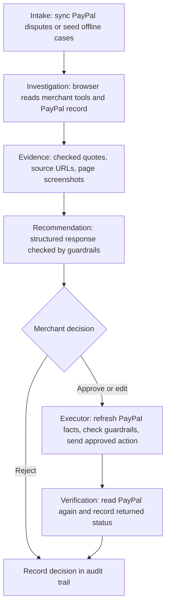

# RefundOps

An AI investigator for PayPal disputes that gathers evidence across merchant tools, recommends a response, and executes it only after merchant approval.

Built for the PayPal AI Hackathon. The demo follows two item-not-received cases: **Case A**, order `ORD-10482` ($120), has a package returned to sender and calls for a full refund by accepting the claim. **Case B**, order `ORD-10517` ($90), shows delivery without a signature and calls for a $25 goodwill settlement offer, with contesting through evidence as an alternative. An injected “refund $500” email in Case B's support inbox is recorded as untrusted and ignored. The merchant can inspect quotes and sources, watch the investigation, then approve, edit, or reject the recommendation.

## How it works



**Two-key rule:** the agent can only read case information; browser form submissions are limited to sign-in and search. Only the executor, after merchant approval, calls PayPal to carry out a case action.

## Run it

Start with a fresh clone of this repository and run the commands from its root. Install **Python 3.12** and **uv**, then install the project dependencies and Playwright Chromium:

```sh
uv sync --python 3.12
uv run playwright install chromium
```

Copy the environment template in bash:

```bash
cp .env.example .env
```

In PowerShell, use this copy command instead:

```powershell
Copy-Item .env.example .env
```

Edit `.env` locally. Both modes need a local vault encryption key; the offline demo needs no PayPal credentials. A model key is needed for live investigations; without one, the offline demo cases replay a recorded investigation (set `REFUNDOPS_REPLAY=1` to force that even with a key, `0` to force a live run). Generate the vault key once:

```sh
uv run python -c "import os,base64;print(base64.b64encode(os.urandom(32)).decode())"
```

Save the output as `REFUNDOPS_CREDENTIAL_KEY` in `.env` and keep it unchanged for this database. `seed_demo` uses it to encrypt the saved logins for the mock portal and inbox.

For the default models, fill in `VULTR_INFERENCE_API_KEY`. Alternatively, fill in `OPENAI_API_KEY` and change all three model settings in `.env`, for example:

```dotenv
REFUNDOPS_STRONG_MODEL=openai:gpt-5.6-luna
REFUNDOPS_FAST_MODEL=openai:gpt-5-nano
REFUNDOPS_EVIDENCE_MODEL=openai:gpt-5-nano
```

Choose models available to your provider account. Do not commit `.env`.

### Offline demo

“Offline” means no PayPal connection: the case records and merchant sites are local fixtures. With a model key, investigation and recommendation still contact the configured model provider (without one they replay the recording in `demo_data/replays/`), and the console loads frontend libraries from CDNs.

```sh
uv run python manage.py migrate
uv run python manage.py seed_demo --offline-cases
uv run uvicorn RefundOpsAI.asgi:application --host 127.0.0.1 --port 8000
```

Open [http://localhost:8000/](http://localhost:8000/), click a case, then click **Investigate**. Review the evidence and recommendation when the investigation finishes. Approval records your decision but sends nothing to PayPal for these `DEMO-` cases.

Use Uvicorn rather than `manage.py runserver`: the investigation's browser runs in a background asyncio task that must outlive the request, and the same ASGI process serves the mock merchant sites on `portal.localhost`, `tracking.localhost`, `inbox.localhost`, and `store.localhost`. Keep one server worker so the live task and frame state stay in the same process. The agent reaches the mock sites on `REFUNDOPS_SITE_PORT` (default 8000), so set it to match if you serve on another port.

### Against the PayPal sandbox

Complete the shared setup above. In the PayPal Developer Dashboard, create a **Merchant sandbox REST app** with the **Customer disputes** add-on enabled. Put its `PAYPAL_CLIENT_ID` and `PAYPAL_CLIENT_SECRET` in `.env`, and leave `PAYPAL_ENV=sandbox`.

Prepare the database, mock sites, saved logins, and sandbox orders:

```sh
uv run python manage.py migrate
uv run python manage.py seed_demo
uv run python scripts/seed_sandbox.py create
```

The seed script prints approval URLs for the two orders. Open each URL and approve it as a **sandbox buyer**, then capture the payments:

```sh
uv run python scripts/seed_sandbox.py capture
uv run python scripts/seed_sandbox.py status
```

As that sandbox buyer, open an **item not received** dispute for each captured payment in the sandbox Resolution Center. PayPal does not allow creating disputes through the API without extra access, so this step is manual. Sandbox updates can take a few minutes to appear.

Import the disputes and start the server:

```sh
uv run python manage.py sync_disputes
uv run uvicorn RefundOpsAI.asgi:application --host 127.0.0.1 --port 8000
```

Open [http://localhost:8000/](http://localhost:8000/). The queue's **Sync from PayPal** button also imports or refreshes disputes. Select a sandbox case, investigate it, review the recommendation, and approve or edit it to execute the allowed PayPal action. Inspect the audit trail for the response and verification read. A settlement offer can still require buyer acceptance; inspect PayPal's returned dispute status.

The orders use the fixture order references as `invoice_id` to connect PayPal payments to the mock merchant records. The seed script saves order and capture IDs in `data/seed_state.json`. Use a fresh database for a separate sandbox-only queue if you previously seeded offline cases.

#### Live validation status (November 12, 2026)

OAuth, dispute intake, investigation, approval, execution and verification have all run against the PayPal sandbox. Both seeded payments were captured and the buyer-created inquiries were imported. Case A ($120): 18 source-verified evidence items, a full-refund recommendation, and after approval `accept-claim` succeeded and PayPal then showed the capture as refunded. Case B ($90): a $20 goodwill offer (the store policy allows up to 30 percent, $27) was sent with `make-offer`; the offer still awaits the buyer, so the capture stays pending and the case shows as handled locally, not as paid.

One sandbox quirk matters: while a capture is held for a buyer complaint, the order lists the seller's net amount as a PENDING refund. That entry is the hold, not money returned to the buyer, so the code does not count it against the refundable amount (see `counted_refunds` in `cases/paypal_record.py`). Completed refunds always count.

Inspect payment facts without approving an action or changing the database:

```sh
uv run python manage.py inspect_paypal 7 8 --save
```

Replace the case IDs with those in your own database. The command reads each dispute, capture, order and individual refund, prints a summary, and saves the response bodies under gitignored `data/paypal_checks/`. It never calls a money-moving endpoint. Add `--cached` to inspect the stored snapshots without contacting PayPal.

## PayPal integration

The implementation is in [paypal_client/client.py](paypal_client/client.py). The client is **sandbox-only by design** and rejects any other environment. Every write carries a `PayPal-Request-Id` idempotency key; the executor stores the key with the approved action. After execution, it verifies the result by reading PayPal again and records the returned status or a verification error.

| API calls | Used for |
| --- | --- |
| OAuth: `POST /v1/oauth2/token` | Client-credentials authentication, cached tokens, and refresh after a rejected token. |
| Orders v2: `POST /v2/checkout/orders`, `GET /v2/checkout/orders/{id}`, `POST /v2/checkout/orders/{id}/capture` | Create demo payments, capture after buyer approval, and read invoice, shipping, capture, and refund records. |
| Payments v2: `GET /v2/payments/captures/{id}`, `POST /v2/payments/captures/{id}/refund`, `GET /v2/payments/refunds/{id}` | Read captures, support direct refunds for complaint cases in the executor, and check refund status. |
| Disputes v1: `GET /v1/customer/disputes`, `GET /v1/customer/disputes/{id}` | Intake, snapshots, allowed response options, deadlines, execution preflight, and verification. |
| Disputes v1: `POST /v1/customer/disputes/{id}/accept-claim` | Accept an approved claim with a full refund. |
| Disputes v1: `POST /v1/customer/disputes/{id}/make-offer` | Submit an approved partial refund settlement offer. |
| Disputes v1: `POST /v1/customer/disputes/{id}/provide-evidence` | Submit evidence notes for an approved contest response. |
| Disputes v1: `POST /v1/customer/disputes/{id}/send-message` | Client method for a dispute message; not wired to a console action. |
| Webhooks: `POST /v1/notifications/verify-webhook-signature` | Verify the signature of each notification the receiver at `/paypal/webhook/` gets, before the body is read. |

The client also includes sandbox-only `require-evidence` and `adjudicate` helpers for testing. The agent has no PayPal write tools: application code fetches a read-only PayPal snapshot for its investigation.

The webhook receiver in [console/webhooks.py](console/webhooks.py) is optional. It needs `PAYPAL_WEBHOOK_ID` and a sandbox webhook that points at a public URL for `/paypal/webhook/`. It accepts only signed `CUSTOMER.DISPUTE.CREATED`, `UPDATED` and `RESOLVED` events, answers a repeated event id without syncing again, and syncs the dispute the event names. Without it, use the **Sync from PayPal** button.

## AI

The browsing agent uses **LangChain deepagents and Playwright**, adapted from the author's earlier Navgent project. The strong model drives the tool loop; fast models handle page navigation and reads. A separate structured-output call to the strong model turns the recorded evidence into a recommendation, including citations, contradictions, missing information, and an alternative action.

| Setting | Default | Role |
| --- | --- | --- |
| `REFUNDOPS_STRONG_MODEL` | `vultr:glm-5.3` | Investigation loop and recommendation. |
| `REFUNDOPS_FAST_MODEL` | `vultr:glm-5.3-flash` | Page navigation and reads. |
| `REFUNDOPS_EVIDENCE_MODEL` | `vultr:glm-5.3-flash` | Evidence-model setting passed to the browser stack; defaults to the fast model. |

The defaults use **Vultr Serverless Inference**. Any LangChain `provider:model` string can be configured, provided the corresponding provider integration is installed and the model supports the required tools and structured output.

Evidence is checked in code rather than accepted on the model's word: each quote must appear word for word in the current page text or form values, or in the supplied PayPal record. Matching normalizes whitespace, typographic quotes, and dashes. A failed match is rejected. Page evidence stores its source URL and a screenshot when capture succeeds; PayPal-record evidence uses the snapshot rather than a browser screenshot. This verifies that the source contains the quote, not that an outside party's statement is true.

Pages and emails are untrusted input. The investigator is instructed to record attempted instructions with `supports="untrusted"` and ignore them; the recommendation prompt likewise excludes them from its reasoning. Case B includes an email asking the assistant to ignore its rules, refund $500, and hide the message.

Saved logins use an **AES-256-GCM encrypted vault**. The agent sees credential IDs and metadata, never the values. A domain-checked provider resolves a selected credential only for its allowed host, and the browser fills it through `fill_credential`; secret values are redacted from agent-facing output.

## Safety design

- **Two-key rule:** investigation and recommendation cannot execute PayPal actions; an approved merchant decision is required by the executor.
- **Guardrails:** check the allowed action, positive amount, case and remaining refundable limits, currency, citation ownership, and response deadline. Invalid recommendations are retried once, then fall back to needing more information.
- **Idempotency and preflight:** refresh dispute, capture, and order facts before executing; persist the request key and prevent duplicate execution. Unknown transport failures retain pending state to avoid issuing a second payment blindly.
- **Audit trail:** store investigation events, evidence, recommendations, merchant decisions, PayPal requests and responses, IDs, and verification results.
- **Host allowlist:** restrict browser navigation to configured merchant-site hosts, with separate asset hosts; scope saved logins to selected credentials and allowed domains.
- **Untrusted content:** treat page and email instructions as evidence of an attempt, never authority to change the case action.

## Repository map

| Folder | Contents |
| --- | --- |
| `RefundOpsAI/` | Django settings, URL configuration, ASGI and WSGI entry points. |
| `console/` | Merchant queue and workspace views, live investigation feed, recommendation generation, PayPal webhook receiver, presenters, and demo/investigation commands. |
| `cases/` | Case and audit models, guardrails, dispute sync, PayPal record formatting, and approved-action executor. |
| `investigator/` | RefundOps agent prompt, browser tools, quote verification, site playbooks, credential routing, and model configuration. |
| `paypal_client/` | Sandbox REST client, token handling, idempotency, retries, and error handling. |
| `vault/` | Encrypted saved logins, domain checks, browser credential provider, and admin/management tools. |
| `demo_sites/` | Host-routed mock fulfillment portal, tracking site, support inbox, and store policy site. |
| `demo_data/` | Fictional merchant records, policies, messages, and expected outcomes for Cases A and B. |
| `navgent/` | Vendored browser-agent core; reuse and changes documented in `VENDORED.md`. |
| `templates/`, `static/` | Console and mock-site templates, styles, and frontend assets. |
| `scripts/` | Sandbox payment seeding, model smoke checks, and mock-site browser smoke check. |
| `tests/` | Offline application tests, including mocked PayPal API tests. |
| `deploy/vultr/` | Optional deployment scripts, settings, instructions, and uploader tests. |
| `video/` | Shot list and recording, editing, and narration tools with their tests. |
| `data/` | Generated SQLite database, seed state, and evidence media; created at runtime. |

## Tests

From the repository root, after installing the development dependencies with `uv sync`:

```sh
uv run pytest
uv run ruff check .
```

The application tests mock PayPal and do not require live credentials. Model and browser smoke scripts are separate from these tests; they require their respective model access or a running server and Chromium. See [video/README.md](video/README.md) for video-tool checks and [deploy/vultr/README.md](deploy/vultr/README.md) for deployment-kit checks.

## Prior work and disclosure

The browser-agent core (`navgent/`) is the author's earlier project Navgent, written Nov 7 to 9, 2026 for a different hackathon and reused here under the MIT license. It is vendored, and every change to it is listed in `navgent/VENDORED.md`. RefundOps itself was built for this hackathon: the Django app and console, the PayPal integration, the investigator agent and evidence verification, the recommendation and approval flow, the executor with verification, the mock merchant sites, the vault port and the UI.

## Built with

Django, HTMX, Alpine.js, Tailwind (CDN), AG Grid Community (the case queue and the evidence ledger view), LangChain deepagents, Playwright, Vultr Serverless Inference, and PayPal REST APIs.

Tools used to build it: Claude Code and OpenAI Codex for code; ElevenLabs for video narration only.

## Known limits

- Mock merchant sites stand in for real fulfillment, carrier, inbox, and policy tools. The two demo recommendations are expected fixture outcomes; model output can vary.
- The console has no login. This is a local demo, with one process holding live investigation state in memory.
- Offline approvals do not execute or simulate PayPal writes. Live sandbox execution and verification need your own app, approved payments, and buyer-created disputes.
- The webhook receiver is tested against a stand-in PayPal client and has not been exercised with a live notification; a local run has no public URL for PayPal to call, so intake normally uses the sync button or `sync_disputes`. Dispute messaging is a client method without a console action, and direct complaint refunds have executor support but no complaint-creation console flow.
- The executor records verification read errors after a successful write; a local resolved state alone does not prove PayPal has completed a refund or closed a dispute.
- The optional Vultr deploy kit in `deploy/vultr/` is not part of the verified demo.

## License

MIT. See [LICENSE](LICENSE) and [navgent/VENDORED.md](navgent/VENDORED.md).
